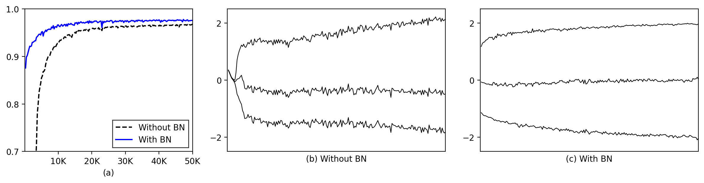

# Batch Normalization: Accelerating Deep Network Training by Reducing Internal Covariate Shift


Implementation in 100 lines of code of the paper [Batch Normalization: Accelerating Deep Network Training by Reducing Internal Covariate Shift](https://arxiv.org/abs/1502.03167).

## Usage

```commandline
$ pip install -r requirements.txt
$ python batch_norm.py
```

## Results


#### (a) The test accuracy of the MNIST network trained with and without Batch Normalization, vs. the number of training steps. (b, c) The evolution of input distributions to a typical sigmoid, over the course of training, shown as {15, 50, 85}th percentiles. Batch Normalization makes the distribution more stable and reduces the internal covariate shift.


 
