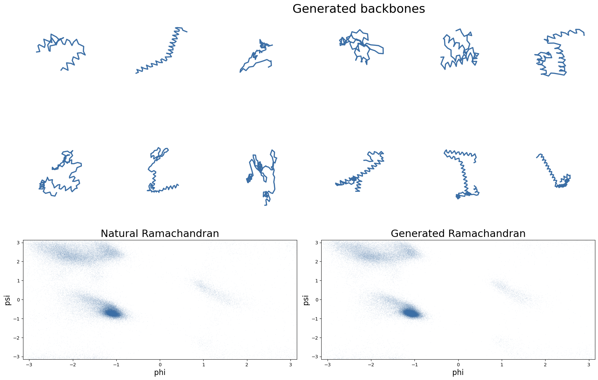

# Protein structure generation via folding diffusion


Implementation in 100 lines of code of the paper [Protein structure generation via folding diffusion](https://arxiv.org/abs/2209.15611).


## Usage

**Dataset:** Download the CATH non-redundant S40 set (737 MB) from [CATH](https://download.cathdb.info/cath/releases/all-releases/v4_3_0/non-redundant-data-sets/cath-dataset-nonredundant-S40-v4_3_0.pdb.tgz), or from [this mirror](https://www.dropbox.com/s/ka5m5lx58477qu6/cath-dataset-nonredundant-S40.pdb.tgz?dl=1). Extract it and put the *dompdb* folder inside the *data* folder.
```commandline
$ pip3 install -r requirements.txt
$ python3 foldingdiff.py
```

## Results


#### Backbones generated from noise, and the Ramachandran plot they occupy.


 
